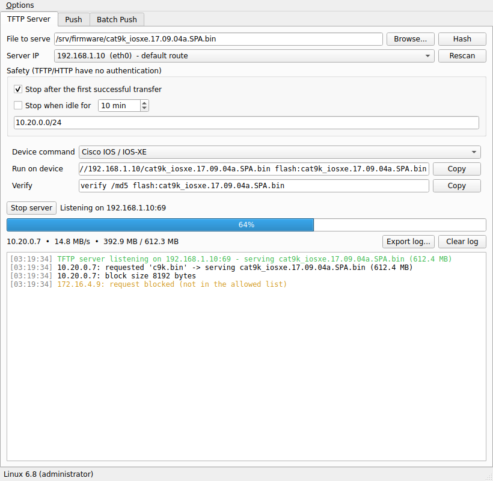
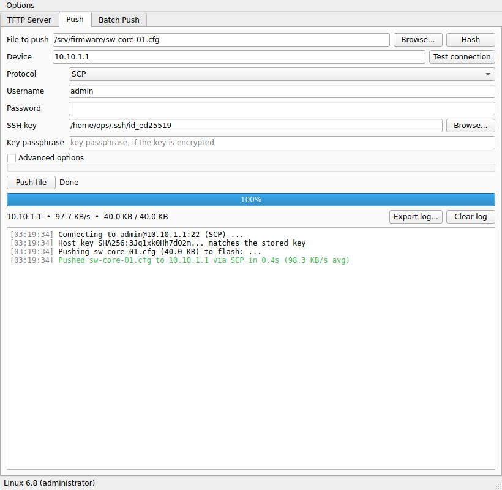
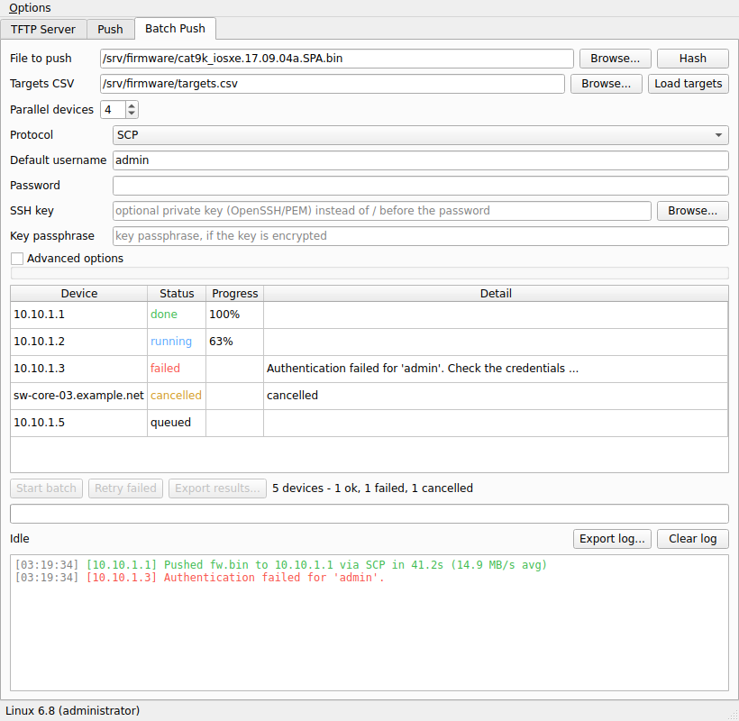

# Network File Transfer

[](https://github.com/duc-mt/nettransfer/actions/workflows/ci.yml)
[](https://github.com/duc-mt/nettransfer/releases/latest)
[](LICENSE)


**Zero-config desktop tool (and headless CLI) for getting files onto network devices** - firmware, configs and images
for switches, routers and firewalls - without setting up a TFTP daemon, an FTP server or hand-typing `scp` commands.

| Tab / command | What it does |
|---|---|
| **TFTP Server** | auto-detects your IP and serves the selected file to any device that asks (UDP 69) |
| **HTTP(S) Server** | the same over HTTP or HTTPS (self-signed), for `copy http://...` on Cisco / Junos |
| **Push** | sends a file to one device over **SCP, SFTP, FTP or FTPS** with a password or SSH key |
| **Batch Push** | one file to many devices from a CSV: parallel, per-device status, *Retry failed*, results export |



<details>
<summary>More screenshots (sample data)</summary>




</details>

Every tab has a live progress bar, speed and a colour-coded log, a **Hash** button (MD5/SHA-256 to compare with the device's
own verify output), drag-and-drop, log export, remembered settings (never passwords), optional desktop notifications and an
audit log. The servers add copy-ready **device commands** for Cisco, Huawei, Fortinet and Junos, and **Safety** controls
(allowlist, stop after the first transfer, idle auto-stop) because TFTP/HTTP have no authentication.

## Install

**Download a ready-made single executable** from the [latest release](https://github.com/duc-mt/nettransfer/releases/latest)
(no Python needed):

| OS | File | Run |
|---|---|---|
| Windows | `NetTransfer-<version>-windows-x64.exe` | double-click |
| macOS | `NetTransfer-<version>-macos-arm64.zip` (Apple Silicon) or `-x86_64.zip` (Intel) | unzip, open `NetTransfer.app` |
| Linux | `NetTransfer-<version>-linux-x86_64.tar.gz` | `tar xzf ...`, then `./nettransfer` |

Each release also has `nettransfer-cli-*` (the headless CLI, no Qt) and `SHA256SUMS.txt` (see
[SECURITY.md](SECURITY.md#verifying-a-download) to verify). Binaries are not code-signed yet, so Windows SmartScreen and macOS
Gatekeeper warn on first launch: [docs/PACKAGING.md](docs/PACKAGING.md#signing-notarization-first-run-warnings) has the one-time steps.

**Or run from source** (Python 3.9+):

```bash
# Cross-platform runner (auto bootstraps .venv and dependencies):
./run

# Windows CMD (if preferred):
scripts\run.bat

# Linux / macOS manual sudo if GUI window fails:
sudo -E ./run
```

### TFTP and privileges

UDP 69 is privileged on Linux and macOS. The app *probes* whether it can bind the port (not just "am I root") and, if not,
shows the exact command for your install: `sudo -E ./nettransfer`, `sudo /Applications/NetTransfer.app/Contents/MacOS/NetTransfer`,
or `sudo python3 run.py`. On Windows no elevation is needed, only a firewall allow. HTTP(S), SCP, SFTP and FTP use unprivileged ports.

## Quick start

1. **Device pulls the file (TFTP/HTTP):** choose the file, check the *Server IP*, press **Start server**, then run the shown
   *Device command* on the device (e.g. `copy tftp://10.0.0.5/fw.bin flash:fw.bin`). The file is served for any requested name.
2. **You push the file (SCP/SFTP/FTP):** open **Push**, pick the file, enter the device and credentials, **Push file**.
3. **Many devices:** open **Batch Push**, load a CSV ([`examples/targets.csv`](examples/targets.csv)), **Start batch**.

Full walkthrough, device recipes and troubleshooting: **[docs/USER_GUIDE.md](docs/USER_GUIDE.md)**.

## Headless CLI

```bash
python run.py serve tftp fw.bin --once --allow 10.0.0.0/24      # or: nettransfer-cli serve ...
python run.py serve http image.tgz --https --idle 300
python run.py push sftp fw.bin 10.0.0.1 -u admin --key ~/.ssh/id_ed25519 --remote /var/tmp/
NT_PW=... python run.py batch scp fw.bin --targets examples/targets.csv -u admin --password-env NT_PW --results out.csv
python run.py test scp 10.0.0.1          # reachability + banner + host key, no login
python run.py hash fw.bin

# beyond copying - see "Checks, installs and inventories" in the user guide
python run.py push scp fw.bin 10.0.0.1 -u admin --remote flash: --vendor cisco-ios --preflight --verify --install   # dry run
python run.py batch sftp fw.bin --inventory hosts.yml --filter "site:DCTT vendor:fortinet" --retries 2 --resume
python run.py push scp fw.bin 10.9.0.1 -u admin --jump ops@bastion.example --verify-cmd "sha256sum {path}"
python run.py serve http fw.bin --to 10.0.0.1 --https --cert lab.pem --key lab.key
python run.py commands http fw.swi --to 10.0.0.1 --vendor arista    # copy-ready device commands for ~15 platforms
python run.py verify 10.0.0.1 --vendor fortinet -u admin --password-env FG_PW --expect-version 7.2.4   # after a device-side pull
python run.py batch sftp fw.bin --inventory hosts.yml --filter "vendor:cisco-ios" --verify --vendor cisco-ios
python run.py push scp fw.swi 10.0.0.1 -u admin --vendor arista-eos --verify --set-boot --reload-in 10   # dry run; add --execute
python run.py audit && python run.py history --html history.html     # tamper check + who got which file
python run.py web --files ./images                                    # token-protected browser control panel
```

Also in the CLI and the Push/Batch tabs: post-transfer **verification** against the device's own digest
(`VERIFIED (hash match)` / `FAILED (checksum mismatch)`, or a version check where a platform has no hash command), free-space/extension **pre-flight**, opt-in **boot-image and
reload hooks** (dry run by default, explicit confirmation before anything is applied),
**retries with backoff** and SFTP/FTP **resume**, **jump host** support, Ansible /
Netmiko / Zabbix **inventories with tag filters**, OS **keyring** credentials, a **hash-chained audit log** with an HTML
**history report**, IPv6 for HTTP(S), and a **Docker image** for the CLI.

Passwords are never accepted as arguments (they would show in `ps`): use `--password-env VAR` or the prompt.
Exit codes: `0` ok, `1` failure, `2` usage/CSV error, `130` interrupted.

## Security in one paragraph

TFTP, HTTP and FTP are unauthenticated and/or unencrypted by design, so run the servers on a management network, only while
needed, with the Safety options on. SSH host keys are trusted on first use and a *changed* key is refused until you accept it.
Passwords and passphrases are never stored or logged. Details and how to report a vulnerability: [SECURITY.md](SECURITY.md).

## Project

* [docs/USER_GUIDE.md](docs/USER_GUIDE.md) - usage, device recipes, troubleshooting
* [docs/ARCHITECTURE.md](docs/ARCHITECTURE.md) - how it is built and why
* [docs/PACKAGING.md](docs/PACKAGING.md) - building the executables, signing, platform notes
* [docs/RELEASING.md](docs/RELEASING.md) - maintainers: cutting a release
* [CONTRIBUTING.md](CONTRIBUTING.md) - dev setup, tests, how to add things
* [CHANGELOG.md](CHANGELOG.md) - what changed

Built with [PySide6](https://doc.qt.io/qtforpython-6/), [tftpy](https://github.com/msoulier/tftpy),
[paramiko](https://www.paramiko.org/), [scp](https://github.com/jbardin/scp.py) and [PyInstaller](https://pyinstaller.org/).
Released under the [MIT License](LICENSE).
